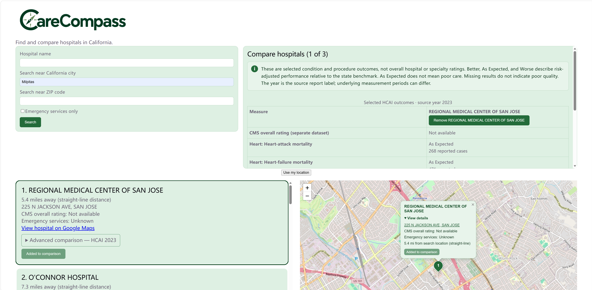
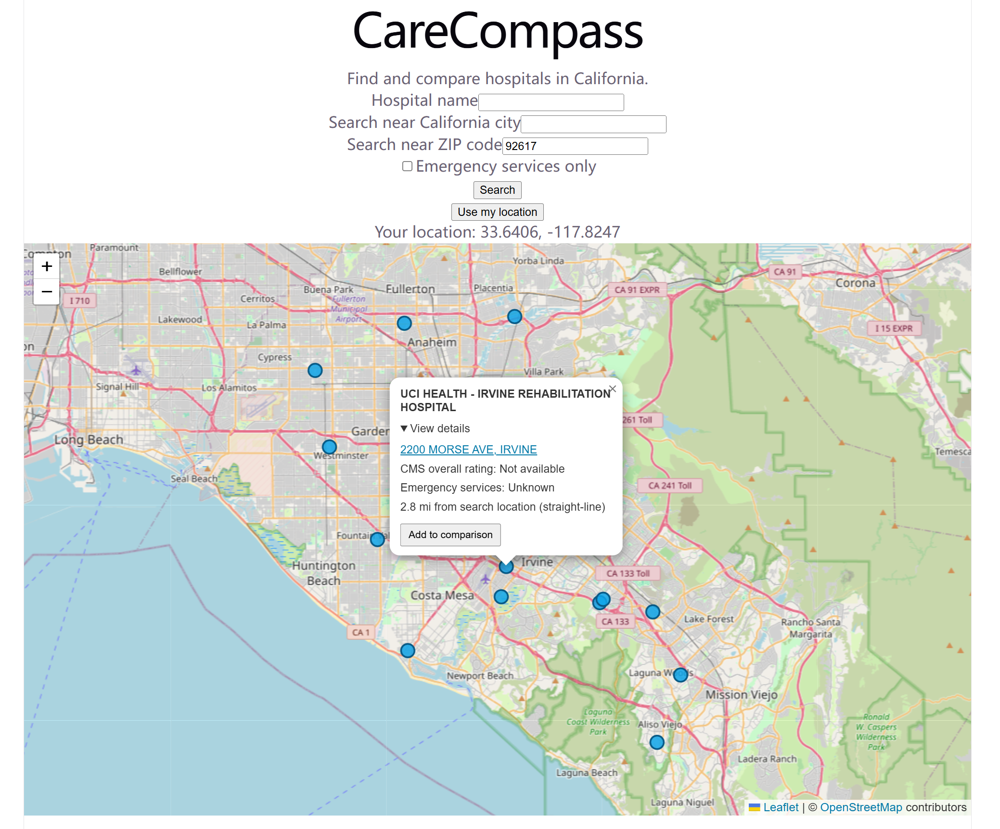
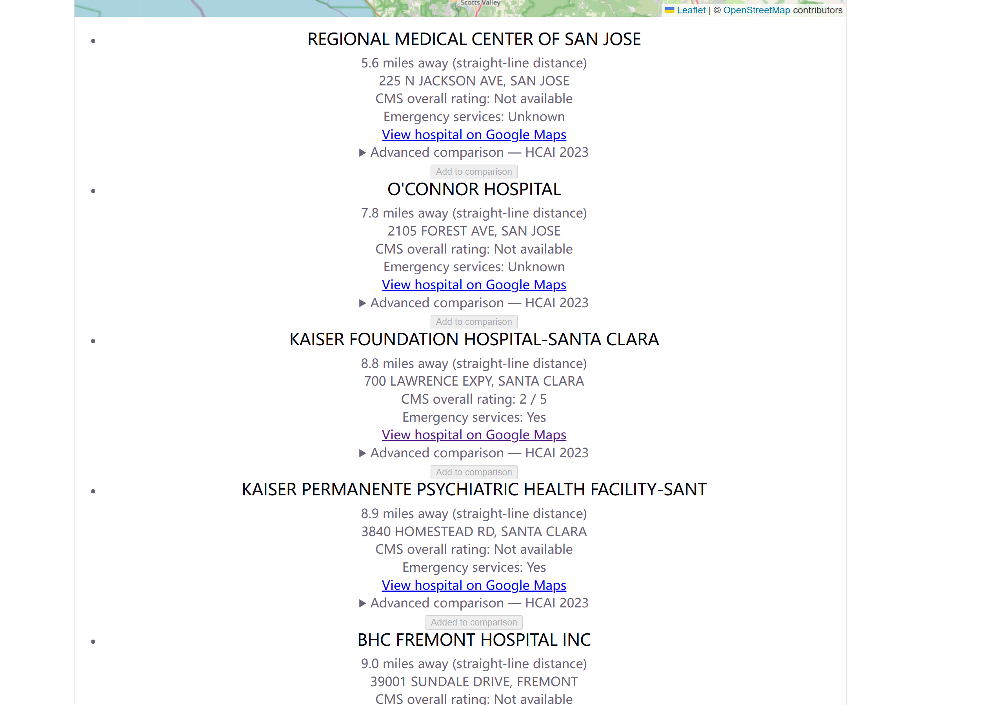
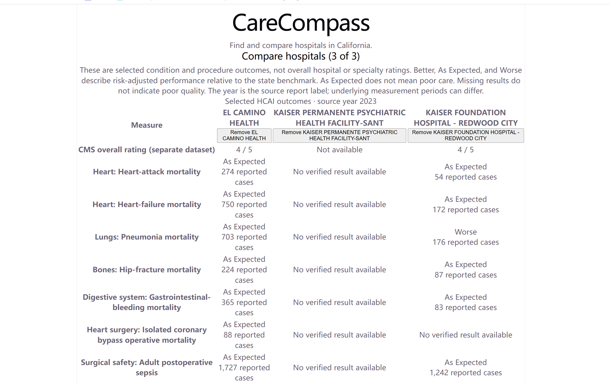

# CareCompass v2.0

CareCompass is a California hospital discovery and comparison project. Search near a city, ZIP code, or browser location, explore hospital locations on a map, and compare published quality information.

**Status:** Local MVP. Public deployment is pending; the v2.0 label identifies this development milestone, not a production-readiness certification.

## What you can do

- Find hospitals near a California city or US ZIP code, or use browser location.
- Filter by hospital name and reported emergency services.
- Browse a scrollable hospital list alongside a map with numbered pins matching the results.
- Select a hospital card to center the map and open its details; select it again to return to the results view. Open linked addresses in Google Maps.
- Add up to three hospitals to a comparison from the map or list.
- View CMS overall ratings separately from seven selected 2023 HCAI outcomes.
- Use the compact search and comparison panels side by side on wider screens; the layout adapts to smaller screens.

Search location priority is **ZIP → city → browser location**. The interface currently displays up to **20 hospitals per search**; the map represents those results rather than the entire directory. City and ZIP coordinates are estimates, and distances are straight-line estimates rather than driving distances. Comparison selections are kept in memory and reset when the page reloads.

## Screenshots

Visible ratings and service flags are snapshot data, not endorsements or confirmation of current availability.

### CareCompass v2.0 overview

Search near Milpitas, select a hospital to center the map and open its details, and add it to the comparison panel.



The following screenshots show the earlier interface and will be replaced as updated screenshots become available.

### Search and map details

Search near ZIP 92617 and expand a hospital popup to see its linked address, available CMS rating, emergency-service status, estimated distance, and comparison button. ZIP input takes priority over the browser coordinates also visible in this example.



<details>
<summary>Hospital list with available and missing information</summary>

Results show straight-line distances, Google Maps links, and expandable HCAI information. Unavailable CMS ratings and unknown emergency-service status remain explicit; neither establishes poor quality or the absence of an emergency department.



</details>

<details>
<summary>Side-by-side comparison of three hospitals</summary>

CMS overall ratings appear separately from selected HCAI outcomes and reported case counts. This example includes missing results to illustrate the limits of comparison; a missing value is not a zero rating.



</details>

## Current data coverage

Verified against the local database on **October 25, 2026**. These figures describe this project's imported snapshot, not all hospitals in California or nationwide.

| Coverage | Count |
| --- | ---: |
| California CMS provider records retained | 377 |
| Additional California hospital location records | 64 |
| Searchable hospital locations | **320** |
| Searchable locations with a CMS overall rating | 189 / 320 (59.1%) |
| Searchable locations without a CMS overall rating | 131 / 320 (40.9%) |
| Locations with at least one selected HCAI outcome rating | 221 / 320 (69.1%) |
| Locations with all seven selected HCAI outcome ratings | 74 / 320 (23.1%) |
| Locations with CMS overall or selected HCAI rating information | 224 / 320 (70.0%) |
| Reported emergency services: yes / no / unknown | 194 / 63 / 63 |

**Provider records and physical hospital locations are different units.** The 377 CMS records plus 64 additional locations do not represent 441 distinct searchable hospitals. Unresolved coordinates, campus relationships, duplicates, and scope decisions affect which records appear in search.

### Hospital scope and source differences

The directory includes general hospitals and selected specialty hospitals, including rehabilitation, cancer, and surgical facilities. It is **not a comprehensive directory** of hospitals or specialty care. Clinics, family doctors, dental practices, pharmacies, and skilled nursing facilities are outside the current directory's scope.

CMS is a national provider dataset; the California facility listing uses state facility and location records. Their identifiers, names, addresses, reporting periods, and campus structures do not always align. Some California locations have no matching CMS provider ID or rating, and one provider record does not necessarily describe every campus separately. An unmatched record does not, by itself, mean a hospital is missing from all national data.

Original provider data is retained separately from location selections. Missing ratings are not invented or copied from another campus. Unresolved or conflicting matches can leave locations outside search or cause performance results to be withheld.

### Ratings and emergency-service limitations

- **CMS:** Overall-rating coverage is incomplete. An unavailable rating is not zero stars and does not establish poor quality.
- **HCAI:** Only seven selected outcomes from source year 2023 are included: heart attack, heart failure, pneumonia, hip fracture, gastrointestinal bleeding, isolated CABG mortality, and adult postoperative sepsis. These are not comprehensive performance or specialty ratings. Historical results do not establish current performance; some locations and measures have no verified result.
- **Separate measures:** CMS overall ratings and HCAI outcome categories are different measures. The combined 70.0% information-coverage figure is not overall-rating coverage or a combined quality score.
- **Emergency services:** The flag is reported source information, with incomplete coverage. Unknown does not mean no emergency department. The emergency-only filter includes only records marked yes, so it can omit facilities whose status is unknown. No live opening status, capacity, wait times, or service availability is provided.

## Disclaimer

CareCompass is an informational project, **not medical advice, an emergency-response service, or a recommendation of a particular hospital**. Do not rely on it to decide where to obtain emergency care. Data may be incomplete, outdated, or associated with an unresolved provider/campus relationship. Inclusion does not independently verify a facility's location or services. Confirm addresses, services, and other relevant details directly with the facility and consult qualified healthcare professionals for care decisions.

## Technology

React, TypeScript, Leaflet/OpenStreetMap, Python/FastAPI, PostgreSQL, Docker for the local database, and pgeocode/GeoNames for postal lookups. AWS and Kubernetes are not part of the current implementation.

## Run locally (PowerShell)

Requires Python 3.11+, Node.js, Docker Desktop, and the **existing populated CareCompass database**, including the `hospital_search` view and HCAI tables. A fresh clone does not include the source datasets or a fully automated database bootstrap.

From the project root, create `.env` from `.env.example` if it does not exist and set your local database password. Never commit credentials. Changing this file does not change an already initialized database password.

```powershell
py -m venv .venv # Only if .venv does not exist
.\.venv\Scripts\python.exe -m pip install -r requirements.txt
docker compose up -d
.\.venv\Scripts\python.exe -m uvicorn app.main:app --reload --port 8000
```

In a second terminal, from the project root:

```powershell
cd frontend
npm.cmd ci
npm.cmd run dev
```

Open [CareCompass](http://localhost:5173) or [API documentation](http://127.0.0.1:8000/docs). Use the frontend URL printed in the terminal if its port differs. First postal lookup downloads data; subsequent lookups use a local cache that must also be provisioned for deployment.

## Sources and attribution

- [CMS Hospital General Information](https://data.cms.gov/provider-data/dataset/xubh-q36u): provider identity, overall ratings, and emergency-service indicators.
- [California licensed and certified facility listing](https://data.ca.gov/@california-department-of-public-health/licensed-and-certified-healthcare-facility-listing): state facility/location records; Creative Commons Attribution.
- [HCAI Hospital Performance Ratings](https://hcai.ca.gov/visualizations/hospital-performance-ratings-summary-report/): selected 2023 outcomes.
- [GeoNames postal data](https://download.geonames.org/export/zip/): estimated postal coordinates, accessed through pgeocode; CC BY attribution.
- [OpenStreetMap contributors](https://www.openstreetmap.org/copyright): map data and attribution. Public tile service availability is subject to its usage policy.
